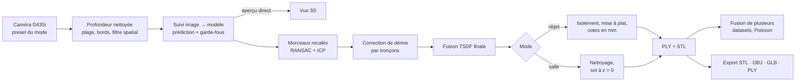

# 3DScan · D435i

**Scanner 3D de bureau pour la caméra Intel® RealSense™ D435i.**
Tu choisis ce que tu scannes, tu tournes autour, et le modèle se construit sous tes yeux, en couleurs,
coté en millimètres, prêt pour l'impression 3D ou la CAO.

```
┌──────────── Datasets ─────────────┬──────── Caméra en direct ────────┬────────── Aperçu 3D ───────────┐
│ ☑ 23 nov. · Objet · 1676 img  ✓   │  ● Distance idéale (21 cm)       │              [Exporter ▾]      │
│ ☑ 22 nov. · Objet ·  940 img  ✓   │   ┌──────────────────────────┐   │      modèle qui se remplit     │
│ [ 2 cochés    Fusionner ]         │   │ ▲▲ ●● ●●●  couverture    │   │      (rouge → vert selon la    │
│  [aperçu image par image]         │   └──────────────────────────┘   │      couverture), puis modèle  │
│  Standard | Détaillé  ☑ Lissage   │   ┌──── profondeur ──────────┐   │                                │
│  [ Construire le modèle 3D ]      │   └──────────────────────────┘   │  Couleur · Relief · Maillage   │
│                                   │   ( ● )  00:42   1 268 img       │  Cotes · Iso · Dessus · Capture│
└───────────────────────────────────┴──────────────────────────────────┴────────────────────────────────┘
```

## Points forts

- **Deux modes pensés pour leur sujet** : *Objet* (petit ≤ 10 cm ou moyen 10–60 cm) et *Salle entière*.
  Chacun règle la caméra (preset, unité de profondeur, portée, filtres) et la reconstruction.
- **Reconstruction en direct** sur la carte graphique, affichée à droite de l'image caméra.
- **Couverture en temps réel** : pendant l'enregistrement, une grille de marqueurs sur l'image caméra
  montre ce qui reste à scanner (▲ rouge), ce qui est partiel (● ambre) et ce qui est bien vu (● vert) ;
  le nuage 3D est coloré de la même façon pour repérer les zones à repasser sous tous les angles.
- **Guidage à l'écran** : distance idéale, état du suivi, coupe du fond (plateau tournant).
- **Datasets intégrés** : aperçu image par image, construction en un clic, historique des modèles et de
  leurs cotes.
- **Fusion de datasets** depuis le panneau latéral : coche plusieurs scans (dessus puis dessous d'un objet
  retourné, salle en plusieurs passages), ils sont recalés et réunis en une surface unique et étanche.
- **Export en un clic** : STL (impression, CAO), OBJ et GLB (Blender, en mètres, couleurs comprises), PLY.
- **Résultats utilisables directement** : objet isolé de son support, posé à plat et coté en mm ; salle
  nettoyée et posée sur son sol.
- **Suivi robuste** : prédiction de mouvement, garde-fous, découpage en morceaux recalés quand la caméra
  décroche, correction de la dérive en fin de tour ([mesures](docs/precision.md)).

## Démarrer

```bash
git clone https://github.com/balazsralph/3DScan-D435I-Realsense.git
cd 3DScan-D435I-Realsense
python3 -m venv .venv && .venv/bin/pip install -e ".[dev]"
./scanner3d.sh
```

Prérequis : Python ≥ 3.10, D435/D435i en **USB 3**, règles udev de librealsense. Une carte NVIDIA
(CUDA) est conseillée pour la reconstruction en direct ; sans elle, tout le reste fonctionne sur CPU.

| Commande | Effet |
|---|---|
| `./scanner3d.sh` | interface, écran d'accueil |
| `./scanner3d.sh --mode objet_petit` | interface, directement dans un mode (`objet_petit`, `objet`, `salle`) |
| `./scanner3d.sh build DOSSIER` | construit un dataset sans interface (`--qualite fin`, `--profondeur-max 0.45`…) |
| `./scanner3d.sh --datasets ~/Scans` | range les datasets ailleurs (ou variable `SCANNER3D_DATASETS`) |

## Comment ça marche



Détails : [fonctionnement](docs/fonctionnement.md) · conseils : [guide de scan](docs/guide-de-scan.md) ·
chiffres : [précision et mesures](docs/precision.md).

## Organisation du dépôt

```
src/scanner3d/
├── cli.py, paths.py      ligne de commande, emplacements des données
├── profiles.py           modes de scan (caméra + reconstruction)
├── dataset.py, depth.py  datasets RGB-D, traitements de profondeur
├── presets/              presets caméra JSON
├── acquisition/          caméra RealSense, enregistrement
├── export.py             export STL, OBJ, GLB (glTF), PLY
├── reconstruction/       suivi, couverture, recalage, isolement, salle, fusion, chaîne complète
└── gui/                  interface Qt (PySide6) et vue 3D (VTK/PyVista)
tests/
├── unit/  integration/  gui/  helpers/
docs/                     guide de scan, fonctionnement, précision
datasets/                 tes captures (non versionnées)
```

## Développement

```bash
.venv/bin/python -m pytest            # 93 tests, dont des scans et une fusion synthétiques complets
.venv/bin/ruff check src tests
```

## Feuille de route

- Graphe de poses global pour fermer complètement les boucles.
- Verticale et aide au suivi grâce à l'IMU du D435i.
- Texture plus nette par optimisation des couleurs.
- Retournement de l'objet pour scanner aussi son dessous.
